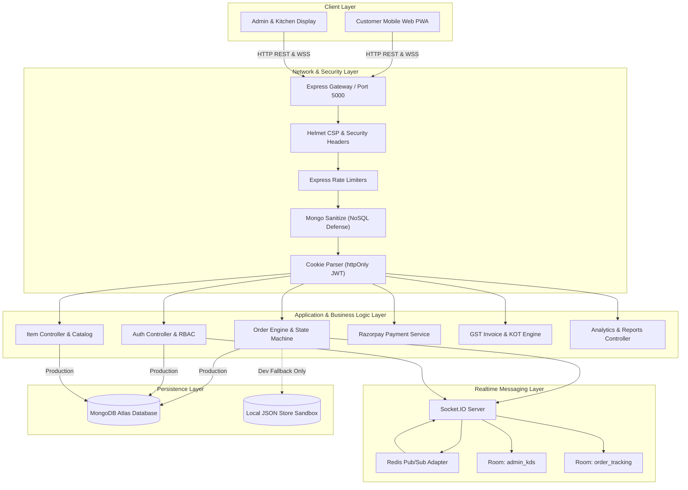
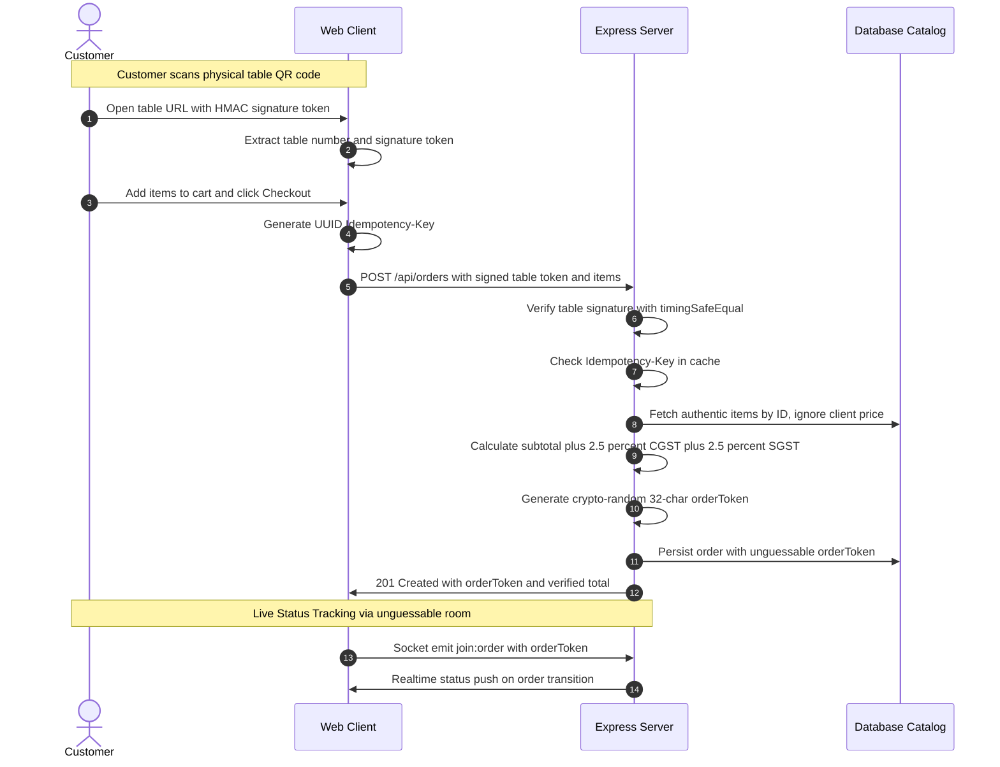
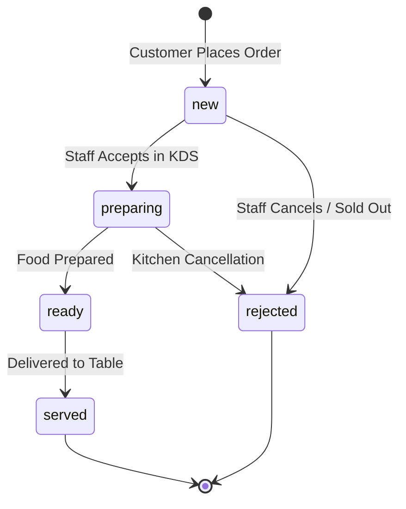
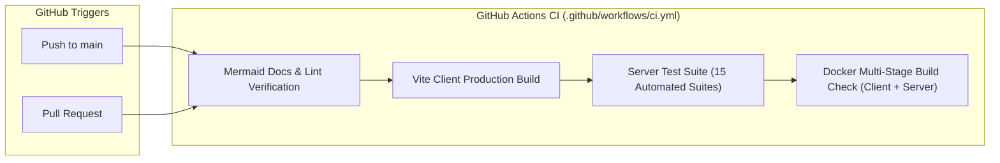
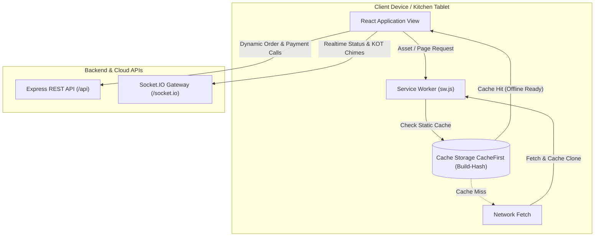
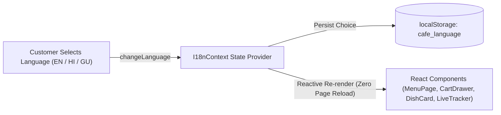

# ☕ Café Emerald — Enterprise MERN QR Table Ordering & Kitchen KDS

> **Production-Grade, Contactless QR Table Ordering & Real-Time Kitchen Display System (KDS)** built with React 18 (Vite), Tailwind CSS, Framer Motion, Node.js, Express, MongoDB/Mongoose, Socket.io, Redis Adapter, and Razorpay UPI.

---

## 📑 Table of Contents
- [1. Production Roadmap & Phase Ledger](#1-production-roadmap--phase-ledger)
- [2. System Architecture](#2-system-architecture)
- [3. Security Architecture & Threat Mitigation](#3-security-architecture--threat-mitigation)
- [4. Order State Machine](#4-order-state-machine)
- [5. Realtime Reliability & Redis Scaling](#5-realtime-reliability--redis-scaling)
- [6. Payments, UPI & GST Invoicing](#6-payments-upi--gst-invoicing)
- [7. Complete REST API Reference](#7-complete-rest-api-reference)
- [8. Automated Test Suite (Phases 1–5)](#8-automated-test-suite-phases-15)
- [9. Quick Start & Local Setup](#9-quick-start--local-setup)
- [10. Docker & Production Deployment](#10-docker--production-deployment)
- [11. CI/CD & DevOps Architecture](#11-cicd--devops-architecture)
- [12. PWA & Kitchen Display Service Worker](#12-pwa--kitchen-display-service-worker)
- [13. Multi-Language i18n (English, Hindi, Gujarati)](#13-multi-language-i18n-english-hindi-gujarati)
- [14. Operations Runbook & OpenAPI Specs](#14-operations-runbook--openapi-specs)
- [15. Contributing & Documentation Standards](#15-contributing--documentation-standards)

---

## 1. Production Roadmap & Phase Ledger

| Phase | Module | Commit | Status | Key Deliverables & Test Verification |
| :--- | :--- | :--- | :--- | :--- |
| **Phase 1** | **P0 Security Hardening** | `fda17ad` | ✅ Completed | Signed table tokens (HMAC-SHA256), DB-only price calculation, idempotency keys, unguessable 32-char `orderToken`, brute-force account lockout (5 bad attempts = 15m lock), rate limiting, `helmet`, `mongo-sanitize`, `httpOnly` cookie JWT. |
| **Phase 2** | **Admin Management** | `cc7f5d4` | ✅ Completed | Items CRUD with Multer image upload, soft-delete (`isDeleted: true`), sold-out toggle (`isAvailable`), master "Accepting Orders" switch, print-ready table QR generator, sales analytics reports, staff accounts management, audit logging. |
| **Phase 3** | **Payments + GST Bill** | `f48f053` | ✅ Completed | Server-enforced state machine (`new` ➔ `preparing` ➔ `ready` ➔ `served`, `rejected`), Razorpay UPI integration with HMAC webhook signature verification, cash "mark paid" button, 80mm thermal printable GST invoice (GSTIN, FSSAI, SAC `996331`, 2.5% CGST + 2.5% SGST) and Kitchen Order Ticket (KOT). |
| **Phase 4** | **Realtime Reliability** | `c4e9c7c` | ✅ Completed | Socket reconnect auto-refetch, HTTP polling fallback (every 8s when disconnected), `@socket.io/redis-adapter` for multi-instance clustering, Web Audio API synthesized kitchen chime (D5 ➔ A5 harmonic fifth) with autoplay unlock. |
| **Phase 5** | **Quality & Test Automation** | `43e32fa` | ✅ Completed | 16 Unit tests (pricing, modifiers, state machine, crypto), 13 Supertest API integration tests, Playwright E2E customer-to-kitchen lifecycle test, k6 load test script (50 concurrent tables). |
| **Phase 6** | **CI/CD & DevOps Hardening** | `97b9001` | ✅ Completed | GitHub Actions CI/CD (`ci.yml`), Pino structured logging with header/token redaction, `/health` and `/ready` probes, graceful SIGTERM/SIGINT shutdown, non-root multi-stage Dockerfiles with HEALTHCHECK, Docker Compose with Mongo + Redis, OpenAPI 3.0 specification (`docs/openapi.yaml`), disaster recovery runbook (`docs/RUNBOOK.md`). |
| **Phase 7** | **Frontend Polish & i18n** | `HEAD` | ✅ Completed | React `ErrorBoundary` with fallback UI, PWA manifest & Service Worker for kitchen tablets, loading skeletons and empty states, full i18n localization in English (EN), Hindi (हिन्दी), and Gujarati (ગુજરાતી) with persistent zero-reload switching. |

---

## 2. System Architecture



---

## 3. Security Architecture & Threat Mitigation



---

## 4. Order State Machine

Order transitions are strictly enforced on the server. Unauthorized status jumps (such as bypassing kitchen preparation directly to `served`) are rejected with HTTP 400.



---

## 5. Realtime Reliability & Redis Scaling

- **Horizontal Scalability:** Socket.IO is configured with `@socket.io/redis-adapter` and `ioredis`. Multi-container setups share order status events seamlessly across instances.
- **Auto-Sync on Reconnect:** When a client's network drops and reconnects, an automated `onReconnect` event fires, immediately fetching `/api/orders` to synchronize any missed status transitions.
- **Dual Polling Fallback:** If WebSocket connections are blocked by strict corporate firewalls or unstable networks, Socket.IO falls back to HTTP long-polling, backed by an application-level 8-second interval poll.
- **Audio Chime:** A synthesized 2-tone melodic notification (D5 587.33 Hz ➔ A5 880.00 Hz) alerts staff of incoming orders without downloading external MP3 files.

---

## 6. Payments, UPI & GST Invoicing

- **Razorpay UPI:** Orders generate precise paise-denominated checkout sessions (`POST /api/payments/razorpay/create-order`). Payment signatures are verified using HMAC-SHA256.
- **Cash "Mark Paid":** Kitchen operators settle counter orders with one click (`PATCH /api/orders/:id/mark-paid`), broadcasting status changes live to the customer.
- **Indian GST Compliance:**
  - **GSTIN:** Configured per café via Settings (`gstin` field in Admin Panel)
  - **FSSAI License:** Configured per café via Settings (`fssai` field in Admin Panel)
  - **SAC Code:** `996331` (Restaurant and food delivery services)
  - **Tax Split:** 2.5% CGST + 2.5% SGST (5% Total GST, configurable in Settings)
- **Thermal Printing (80mm):**
  - Customer Bill: `GET /api/orders/:id/print/bill`
  - Kitchen Order Ticket (KOT): `GET /api/orders/:id/print/kot`

---

## 7. Complete REST API Reference

### Authentication & Staff (`/api/auth`)
| Method | Endpoint | Access | Description |
| :--- | :--- | :--- | :--- |
| `POST` | `/api/auth/login` | Public | Staff/Owner login with rate limiting & lockout. Returns JWT & sets `httpOnly` cookie. |
| `POST` | `/api/auth/logout` | Public | Clears `httpOnly` authentication cookie. |
| `GET` | `/api/auth/me` | Staff / Owner | Returns currently authenticated user session. |
| `GET` | `/api/auth/staff` | Staff / Owner | Lists all staff accounts and active/lockout states. |
| `POST` | `/api/auth/staff` | Owner Only | Provisions a new staff or co-owner account. |
| `DELETE` | `/api/auth/staff/:id` | Owner Only | Removes staff account (owner account protected). |

### Menu Items (`/api/items`)
| Method | Endpoint | Access | Description |
| :--- | :--- | :--- | :--- |
| `GET` | `/api/items` | Public | Returns active menu items (excludes soft-deleted items). |
| `GET` | `/api/items/:id` | Public | Returns single item details. |
| `POST` | `/api/items` | Staff / Owner | Create item with Multer file upload or URL. |
| `PUT` | `/api/items/:id` | Staff / Owner | Update item details, prices, or modifiers. |
| `PATCH` | `/api/items/:id/availability` | Staff / Owner | Toggle sold-out switch; broadcasts live WebSocket event. |
| `DELETE` | `/api/items/:id` | Staff / Owner | Soft-delete item (`isDeleted: true`). |
| `PATCH` | `/api/items/:id/restore` | Staff / Owner | Restore soft-deleted item. |

### Orders & Tracking (`/api/orders`)
| Method | Endpoint | Access | Description |
| :--- | :--- | :--- | :--- |
| `POST` | `/api/orders` | Public (Rate Limited) | Create order with signed table token, server price lookup, and idempotency key. |
| `GET` | `/api/orders/track/:token`| Public | Safe customer tracking by unguessable 32-char token. |
| `GET` | `/api/orders` | Staff / Owner | List orders with date, table, status, and search filters. |
| `GET` | `/api/orders/:id` | Staff / Owner | Get order details by ID. |
| `PATCH` | `/api/orders/:id/status` | Staff / Owner | Advance order state machine (`preparing`, `ready`, `served`, `rejected`). |
| `PATCH` | `/api/orders/:id/mark-paid` | Staff / Owner | Mark cash order as settled. |
| `GET` | `/api/orders/:id/invoice` | Staff / Owner | Returns structured GST invoice data. |
| `GET` | `/api/orders/:id/print/bill`| Staff / Owner | 80mm thermal printable customer bill. |
| `GET` | `/api/orders/:id/print/kot` | Staff / Owner | 80mm thermal printable Kitchen Order Ticket. |

### Tables & QR Codes (`/api/tables`)
| Method | Endpoint | Access | Description |
| :--- | :--- | :--- | :--- |
| `GET` | `/api/tables` | Staff / Owner | Returns table list, signed URLs, PNG QR Data URIs, and occupancy status. |
| `GET` | `/api/tables/:table/qr` | Staff / Owner | Single table signed QR code. |

### Payments (`/api/payments`)
| Method | Endpoint | Access | Description |
| :--- | :--- | :--- | :--- |
| `POST` | `/api/payments/razorpay/create-order` | Public | Initiate Razorpay UPI / Card order. |
| `POST` | `/api/payments/razorpay/verify` | Public | Verify customer payment signature. |
| `POST` | `/api/payments/webhook` | Public | Razorpay webhook listener with HMAC verification. |

### Reports & Settings (`/api/reports`, `/api/settings`)
| Method | Endpoint | Access | Description |
| :--- | :--- | :--- | :--- |
| `GET` | `/api/reports/summary` | Staff / Owner | Today's revenue, order counts, AOV, top 10 items, hourly trends. |
| `GET` | `/api/settings` | Public | Store profile and master "Accepting Orders" status. |
| `PATCH` | `/api/settings` | Staff / Owner | Update café config and toggle master ordering switch. |

---

## 8. Automated Test Suite (Phases 1–5 & Production Suites)

To execute all 15 automated test suites with a single command:
```bash
npm test --prefix server
```

### Complete Test Suite Manifest (15 Suites / 122+ Checks):
```bash
# Phase 1: Security Hardening Suite (15 checks: HMAC tokens, DB pricing, brute-force lockout, idempotency)
node server/test-phase1-security.js

# Phase 2: Admin Management Suite (16 checks: Item CRUD, soft delete, sold-out toggle, QR generator, audit logs)
node server/test-phase2-admin.js

# Phase 3: Payments & GST Bill Suite (21 checks: State machine, Razorpay paise session, cash settlement, 80mm KOT)
node server/test-phase3-payments.js

# Phase 4: Realtime Reliability Suite (6 checks: Redis pub/sub fallback, reconnect refetch, room segregation)
node server/test-phase4-realtime.js

# Phase 5: Unit Tests - Pricing & State Machine (16 checks: Price calculation, modifiers, illegal state jumps)
npm run test:unit --prefix server

# Production Unit: Cookie Domain & Sibling Subdomains (5 checks: .yourcafe.com scoping, Secure + SameSite=Lax)
node server/tests/unit/cookie-domain.test.js

# Production Unit: Smoke Test Guard & isTest Exclusions (5 checks: --allow-prod enforcement, cleanup lifecycle)
node server/tests/unit/smoke-test-guard.test.js

# Production Unit: PWA Automated Cache Version (4 checks: Git SHA build-hash derivation, update prompt trigger)
node server/tests/unit/pwa-build-hash.test.js

# Production Unit: QR Abuse, Table Cap & Payment Gate (5 checks: Max open orders, IP rate limiting, UPI pre-gate)
node server/tests/unit/qr-abuse.test.js

# Production Unit: GST Invoice Sequence & Concurrency (5 checks: Atomic fiscal year sequence, zero gaps/duplicates)
node server/tests/unit/invoice-sequence.test.js

# Production Unit: Legal Policy Pages for Razorpay (3 checks: Privacy, Terms, and Refund & Cancellation disclosures)
node server/tests/unit/policy-pages.test.js

# Production Unit: Deploy Telemetry & Launch Checklist (3 checks: /api/version SHA, staging checklist, pre-launch runbook)
node server/tests/unit/deploy-check.test.js

# Production Unit: Online Payment Setting & Pilot Gate (5 checks: In-flight payment preservation, duplicate webhook idempotent)
node server/tests/unit/online-payment-toggle.test.js

# Production Unit: Atomic Payment Confirmation & Webhook Concurrency (3 checks: Promise.all race, single KDS emission)
node server/tests/unit/atomic-payment-confirmation.test.js

# Phase 5: Supertest REST API Integration (13 checks: End-to-end HTTP pipeline, CSP, rate limiting, auth RBAC)
npm run test:api --prefix server

# End-to-End & Load Testing:
npx playwright test
k6 run load-tests/k6-50-tables.js
```

---

## 9. Quick Start & Local Setup

### 1. Configure Environment Variables
Copy `.env.example` in both directories:
```bash
cp server/.env.example server/.env
cp client/.env.example client/.env
```

### 2. Start Backend Server
```bash
cd server
npm install
node server.js
```
The server runs on **`http://localhost:5000`**.

### 3. Start Frontend Dev Server
```bash
cd client
npm install
npm run dev
```
The client runs on **`http://localhost:5173`**.

- **Customer QR Menu**: [http://localhost:5173/t/1?sig=...](http://localhost:5173)
- **Admin & Kitchen KDS**: [http://localhost:5173/admin](http://localhost:5173/admin)
  - **Credentials:** Set `ADMIN_EMAIL` and `ADMIN_PASSWORD` yourself in your `.env` file before running the seed script or starting the server. Production startup strictly refuses to run without explicit, strong administrator credentials.

---

## 10. Docker & Production Deployment

To spin up the entire application stack containerized:
```bash
docker-compose up --build
```
This builds and runs:
- `server`: Hardened Node.js Express & Socket.IO server on port `5000` (non-root `USER node`, built-in healthchecks).
- `client`: High-performance Nginx Alpine container serving compiled Vite production assets on port `5173`.
- `mongo`: Persistent MongoDB 6.0 container with data volume mount.
- `redis`: High-throughput Redis 7 Alpine cache and pub/sub adapter.

---

## 11. CI/CD & DevOps Architecture

The deployment pipeline is fully automated through GitHub Actions (`.github/workflows/ci.yml`), validating code quality, test suites, and Docker containerization on every pull request and push to `main`.



### Health & Readiness Probes
- **`GET /health`** (Liveness Probe): Returns `{ status: 'ok', uptime, timestamp }`. Used by container orchestrators (Kubernetes/Docker) to detect process hangs.
- **`GET /ready`** (Readiness Probe): Returns `{ status: 'ready', database: 'connected', redis: 'ready' }`. Asserts database connection health before traffic routing.
- **Graceful Shutdown**: Intercepts `SIGTERM` and `SIGINT`, closes HTTP server, disconnects WebSocket clients, terminates MongoDB & Redis connections safely within 10 seconds.

---

## 12. PWA & Kitchen Display Service Worker

Café Emerald incorporates a Progressive Web App (PWA) manifest (`client/public/manifest.json`) and a dedicated Service Worker (`client/public/sw.js`) designed for kitchen tablets and mobile customer devices.



- **PWA Features**: Standalone display mode, dark emerald theme color (`#071a12`), installable on Android/iOS/iPad kitchen tablets.
- **Automated Build-Hash Cache Versioning**: The service worker cache identifier is automatically derived from the Vite build hash (`cafe-emerald-${BUILD_HASH}`) based on Git commit SHA or build timestamp.
- **Automatic Deployment Updates**: When a new version is deployed, the updated service worker activates and immediately alerts the browser. The kitchen tablet and customer UI display an `Update available` notification that reloads into the latest code without manual browser cache clearing.
- **Offline Resilience**: Static assets, fonts, icons, and shell layouts are stored in Cache Storage (`CacheFirst` policy). Dynamic `/api` and `/socket.io` traffic strictly bypasses the cache to ensure zero stale operational data.

---

## 13. Multi-Language i18n (English, Hindi, Gujarati)

The customer ordering interface supports seamless, zero-reload internationalization via the React `I18nContext`:
- 🇬🇧 **English (en)**: Default international locale.
- 🇮🇳 **Hindi हिन्दी (hi)**: Native Hindi terminology (e.g. "ऑर्डर मिला", "तैयार हो रहा है", "कार्ट देखें").
- 🇮🇳 **Gujarati ગુજરાતી (gu)**: Native Gujarati localization (e.g. "ઓર્ડર મળ્યો", "તૈયાર થઈ રહ્યો છે", "કાર્ટ જુઓ").



---

## 14. Operations Runbook & OpenAPI Specs

- **Production Runbook**: Detailed operational procedures are documented in [`docs/RUNBOOK.md`](docs/RUNBOOK.md), covering:
  - Zero-downtime deployment strategies.
  - Automated database backup and point-in-time recovery (`mongodump` / `mongorestore`).
  - Secret rotation runbook for JWT keys, table HMAC secrets, and Razorpay credentials.
  - Offline internet outage and network fallback runbook for café staff.
- **API Documentation**: Full OpenAPI 3.0 specification is available in [`docs/openapi.yaml`](docs/openapi.yaml), importable directly into Postman, Swagger UI, or Insomnia.

---

## 15. Contributing & Documentation Standards

When contributing code, bug fixes, or documentation to Café Emerald, verify the automated check suites before submitting a pull request:

```bash
# Validate documentation Mermaid diagrams
npm run docs:check

# Run backend unit, API, and concurrency test suites
npm test --prefix server

# Run frontend production build
npm run build --prefix client
```

### Mermaid Rules
To guarantee compatibility with GitHub's Markdown renderer and pass the CI `scripts/check-mermaid.js` gate:
- **No semicolons in message text**: In Mermaid sequence diagrams, `;` acts as an inline statement delimiter. Use commas or clean prose instead.
- **No `<br/>` in node labels**: Use concise phrasing or separate nodes rather than raw HTML tags.
- **Quote labels that contain special characters**: Always enclose node and participant labels containing punctuation, parentheses, brackets, colons, or slashes in double quotes (e.g. `["Express Gateway / Port 5000"]`).

