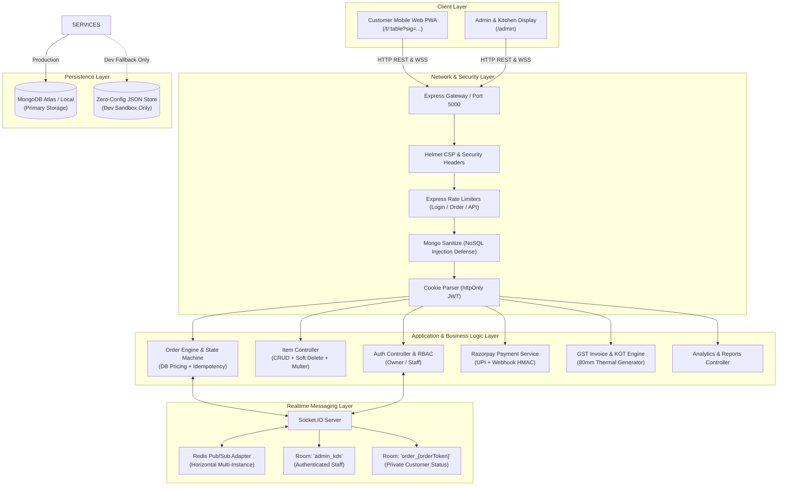
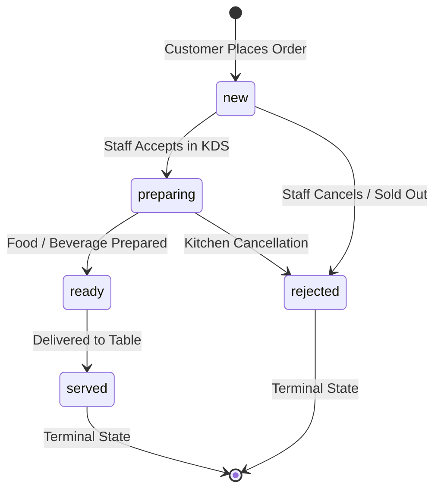

# ☕ Café Emerald — Enterprise MERN QR Table Ordering & Kitchen KDS

> **Production-Grade, Contactless QR Table Ordering & Real-Time Kitchen Display System (KDS)** built with React 18 (Vite), Tailwind CSS, Framer Motion, Node.js, Express, MongoDB/Mongoose, Socket.io, Redis Adapter, and Razorpay UPI.

---

## 📑 Table of Contents
- [1. Production Roadmap & Phase Ledger](#1-production-roadmap--phase-ledger)
- [2. System Architecture](#2-system-architecture)
- [3. Security Architecture & Threat Mitigation](#3-security-architecture--threat-mitigation)
- [4. Order State Machine](#4-order-state-machine)
- [5. Realtime Reliability & Redis Scaling](#5-realtime-reliability--redis-scaling)
- [6. Payments, UPI & GST Invoicing](#6-payments-upi--gst-invoicing)
- [7. Complete REST API Reference](#7-complete-rest-api-reference)
- [8. Automated Test Suite (Phases 1–5)](#8-automated-test-suite-phases-15)
- [9. Quick Start & Local Setup](#9-quick-start--local-setup)
- [10. Docker & Production Deployment](#10-docker--production-deployment)

---

## 1. Production Roadmap & Phase Ledger

| Phase | Module | Commit | Status | Key Deliverables & Test Verification |
| :--- | :--- | :--- | :--- | :--- |
| **Phase 1** | **P0 Security Hardening** | `fda17ad` | ✅ Completed | Signed table tokens (HMAC-SHA256), DB-only price calculation, idempotency keys, unguessable 32-char `orderToken`, brute-force account lockout (5 bad attempts = 15m lock), rate limiting, `helmet`, `mongo-sanitize`, `httpOnly` cookie JWT. |
| **Phase 2** | **Admin Management** | `cc7f5d4` | ✅ Completed | Items CRUD with Multer image upload, soft-delete (`isDeleted: true`), sold-out toggle (`isAvailable`), master "Accepting Orders" switch, print-ready table QR generator, sales analytics reports, staff accounts management, audit logging. |
| **Phase 3** | **Payments + GST Bill** | `f48f053` | ✅ Completed | Server-enforced state machine (`new` ➔ `preparing` ➔ `ready` ➔ `served`, `rejected`), Razorpay UPI integration with HMAC webhook signature verification, cash "mark paid" button, 80mm thermal printable GST invoice (GSTIN, FSSAI, SAC `996331`, 2.5% CGST + 2.5% SGST) and Kitchen Order Ticket (KOT). |
| **Phase 4** | **Realtime Reliability** | `c4e9c7c` | ✅ Completed | Socket reconnect auto-refetch, HTTP polling fallback (every 8s when disconnected), `@socket.io/redis-adapter` for multi-instance clustering, Web Audio API synthesized kitchen chime (D5 ➔ A5 harmonic fifth) with autoplay unlock. |
| **Phase 5** | **Quality & Test Automation** | `HEAD` | ✅ Completed | 16 Unit tests (pricing, modifiers, state machine, crypto), 13 Supertest API integration tests, Playwright E2E customer-to-kitchen lifecycle test, k6 load test script (50 concurrent tables). |
| **Phase 6** | **CI/CD & DevOps Hardening** | In Progress | ⏳ Upcoming | GitHub Actions workflow, Pino logging, Sentry error tracking, `/health` and `/ready` probes, hardened multi-stage Dockerfile with `HEALTHCHECK`. |
| **Phase 7** | **Frontend Polish & i18n** | In Progress | ⏳ Upcoming | Error boundaries, loading skeletons, PWA service worker for kitchen tablets, accessibility contrast pass, multi-lingual support (English, Hindi, Gujarati). |

---

## 2. System Architecture



---

## 3. Security Architecture & Threat Mitigation

```mermaid
sequenceDiagram
    autonumber
    actor Customer as Customer (Table 3)
    participant Client as React Client
    participant Server as Express Server
    participant DB as Database Catalog

    Note over Customer,Client: Customer scans physical table QR code
    Customer->>Client: Open /t/3?sig=3b72c9...
    Client->>Client: Extract table=3 & sig; store in session
    Customer->>Client: Adds item to cart & clicks Checkout
    Client->>Client: Generate UUID Idempotency-Key
    Client->>Server: POST /api/orders { table: 3, tableSig: '3b72c9...', items: [{ id, qty, price: 1 }] }
    
    Server->>Server: Verify table signature timingSafeEqual(sig, HMAC(table))
    Server->>Server: Check Idempotency-Key (Return existing if replayed)
    Server->>DB: Fetch authentic items by ID (Ignore client-sent price: 1)
    Server->>Server: Calculate subtotal + 2.5% CGST + 2.5% SGST = Total
    Server->>Server: Generate crypto-random 32-char orderToken
    Server->>DB: Save Order with unguessable orderToken
    Server->>Client: 201 Created { orderToken: 'f8a9...', total: 273 }
    
    Note over Customer,Server: Live Status Tracking (No sequential ID leaks)
    Client->>Server: Socket emit 'join:order' ('f8a9...')
    Server->>Client: Realtime status push on state transition
```

---

## 4. Order State Machine

Order transitions are strictly enforced on the server. Unauthorized status jumps (such as bypassing kitchen preparation directly to `served`) are rejected with HTTP 400.



---

## 5. Realtime Reliability & Redis Scaling

- **Horizontal Scalability:** Socket.IO is configured with `@socket.io/redis-adapter` and `ioredis`. Multi-container setups share order status events seamlessly across instances.
- **Auto-Sync on Reconnect:** When a client's network drops and reconnects, an automated `onReconnect` event fires, immediately fetching `/api/orders` to synchronize any missed status transitions.
- **Dual Polling Fallback:** If WebSocket connections are blocked by strict corporate firewalls or unstable networks, Socket.IO falls back to HTTP long-polling, backed by an application-level 8-second interval poll.
- **Audio Chime:** A synthesized 2-tone melodic notification (D5 587.33 Hz ➔ A5 880.00 Hz) alerts staff of incoming orders without downloading external MP3 files.

---

## 6. Payments, UPI & GST Invoicing

- **Razorpay UPI:** Orders generate precise paise-denominated checkout sessions (`POST /api/payments/razorpay/create-order`). Payment signatures are verified using HMAC-SHA256.
- **Cash "Mark Paid":** Kitchen operators settle counter orders with one click (`PATCH /api/orders/:id/mark-paid`), broadcasting status changes live to the customer.
- **Indian GST Compliance:**
  - **GSTIN:** `27AAAAA0000A1Z5`
  - **FSSAI License:** `11522018000452`
  - **SAC Code:** `996331` (Restaurant and food delivery services)
  - **Tax Split:** 2.5% CGST + 2.5% SGST (5% Total GST)
- **Thermal Printing (80mm):**
  - Customer Bill: `GET /api/orders/:id/print/bill`
  - Kitchen Order Ticket (KOT): `GET /api/orders/:id/print/kot`

---

## 7. Complete REST API Reference

### Authentication & Staff (`/api/auth`)
| Method | Endpoint | Access | Description |
| :--- | :--- | :--- | :--- |
| `POST` | `/api/auth/login` | Public | Staff/Owner login with rate limiting & lockout. Returns JWT & sets `httpOnly` cookie. |
| `POST` | `/api/auth/logout` | Public | Clears `httpOnly` authentication cookie. |
| `GET` | `/api/auth/me` | Staff / Owner | Returns currently authenticated user session. |
| `GET` | `/api/auth/staff` | Staff / Owner | Lists all staff accounts and active/lockout states. |
| `POST` | `/api/auth/staff` | Owner Only | Provisions a new staff or co-owner account. |
| `DELETE` | `/api/auth/staff/:id` | Owner Only | Removes staff account (owner account protected). |

### Menu Items (`/api/items`)
| Method | Endpoint | Access | Description |
| :--- | :--- | :--- | :--- |
| `GET` | `/api/items` | Public | Returns active menu items (excludes soft-deleted items). |
| `GET` | `/api/items/:id` | Public | Returns single item details. |
| `POST` | `/api/items` | Staff / Owner | Create item with Multer file upload or URL. |
| `PUT` | `/api/items/:id` | Staff / Owner | Update item details, prices, or modifiers. |
| `PATCH` | `/api/items/:id/availability` | Staff / Owner | Toggle sold-out switch; broadcasts live WebSocket event. |
| `DELETE` | `/api/items/:id` | Staff / Owner | Soft-delete item (`isDeleted: true`). |
| `PATCH` | `/api/items/:id/restore` | Staff / Owner | Restore soft-deleted item. |

### Orders & Tracking (`/api/orders`)
| Method | Endpoint | Access | Description |
| :--- | :--- | :--- | :--- |
| `POST` | `/api/orders` | Public (Rate Limited) | Create order with signed table token, server price lookup, and idempotency key. |
| `GET` | `/api/orders/track/:token`| Public | Safe customer tracking by unguessable 32-char token. |
| `GET` | `/api/orders` | Staff / Owner | List orders with date, table, status, and search filters. |
| `GET` | `/api/orders/:id` | Staff / Owner | Get order details by ID. |
| `PATCH` | `/api/orders/:id/status` | Staff / Owner | Advance order state machine (`preparing`, `ready`, `served`, `rejected`). |
| `PATCH` | `/api/orders/:id/mark-paid` | Staff / Owner | Mark cash order as settled. |
| `GET` | `/api/orders/:id/invoice` | Staff / Owner | Returns structured GST invoice data. |
| `GET` | `/api/orders/:id/print/bill`| Staff / Owner | 80mm thermal printable customer bill. |
| `GET` | `/api/orders/:id/print/kot` | Staff / Owner | 80mm thermal printable Kitchen Order Ticket. |

### Tables & QR Codes (`/api/tables`)
| Method | Endpoint | Access | Description |
| :--- | :--- | :--- | :--- |
| `GET` | `/api/tables` | Staff / Owner | Returns table list, signed URLs, PNG QR Data URIs, and occupancy status. |
| `GET` | `/api/tables/:table/qr` | Staff / Owner | Single table signed QR code. |

### Payments (`/api/payments`)
| Method | Endpoint | Access | Description |
| :--- | :--- | :--- | :--- |
| `POST` | `/api/payments/razorpay/create-order` | Public | Initiate Razorpay UPI / Card order. |
| `POST` | `/api/payments/razorpay/verify` | Public | Verify customer payment signature. |
| `POST` | `/api/payments/webhook` | Public | Razorpay webhook listener with HMAC verification. |

### Reports & Settings (`/api/reports`, `/api/settings`)
| Method | Endpoint | Access | Description |
| :--- | :--- | :--- | :--- |
| `GET` | `/api/reports/summary` | Staff / Owner | Today's revenue, order counts, AOV, top 10 items, hourly trends. |
| `GET` | `/api/settings` | Public | Store profile and master "Accepting Orders" status. |
| `PATCH` | `/api/settings` | Staff / Owner | Update café config and toggle master ordering switch. |

---

## 8. Automated Test Suite (Phases 1–5)

To run all 6 test suites across all phases with a single command:
```bash
npm test --prefix server
```

### Individual Test Runners:
```bash
# Phase 1: Security Hardening Suite (15 checks)
node server/test-phase1-security.js

# Phase 2: Admin Management Suite (16 checks)
node server/test-phase2-admin.js

# Phase 3: Payments & GST Bill Suite (21 checks)
node server/test-phase3-payments.js

# Phase 4: Realtime Reliability Suite (6 checks)
node server/test-phase4-realtime.js

# Phase 5: Unit Tests - Pricing & State Machine (16 checks)
npm run test:unit --prefix server

# Phase 5: Supertest REST API Integration (13 checks)
npm run test:api --prefix server

# Phase 5: Playwright End-to-End Test Suite
npx playwright test

# Phase 5: k6 Load Test (50 Concurrent Tables)
k6 run load-tests/k6-50-tables.js
```

---

## 9. Quick Start & Local Setup

### 1. Configure Environment Variables
Copy `.env.example` in both directories:
```bash
cp server/.env.example server/.env
cp client/.env.example client/.env
```

### 2. Start Backend Server
```bash
cd server
npm install
node server.js
```
The server runs on **`http://localhost:5000`**.

### 3. Start Frontend Dev Server
```bash
cd client
npm install
npm run dev
```
The client runs on **`http://localhost:5173`**.

- **Customer QR Menu**: [http://localhost:5173/t/1?sig=...](http://localhost:5173)
- **Admin & Kitchen KDS**: [http://localhost:5173/admin](http://localhost:5173/admin)
  - **Email:** `admin@cafeemerald.com`
  - **Password:** `adminpassword123`

---

## 10. Docker & Production Deployment

To spin up the entire application stack containerized:
```bash
docker-compose up --build
```
This builds and runs:
- `server`: Hardened Node.js Express & Socket.IO server on port `5000`.
- `client`: Optimized Nginx container serving compiled Vite production assets on port `5173`.
