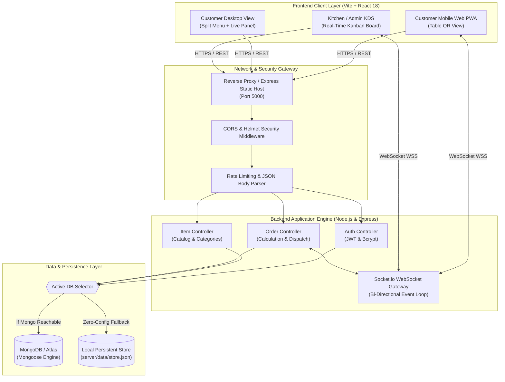
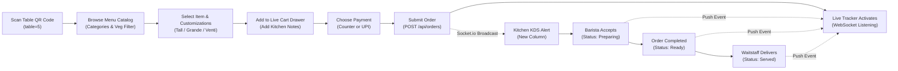
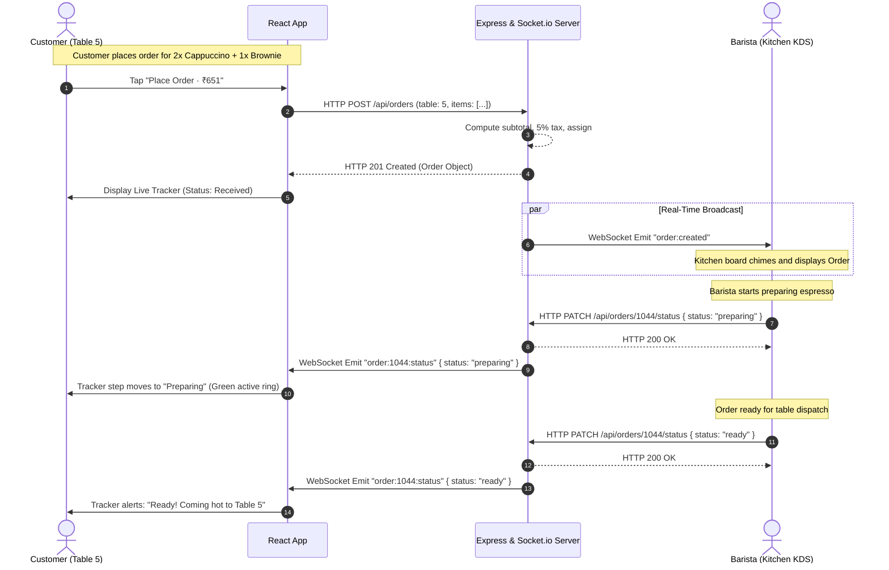
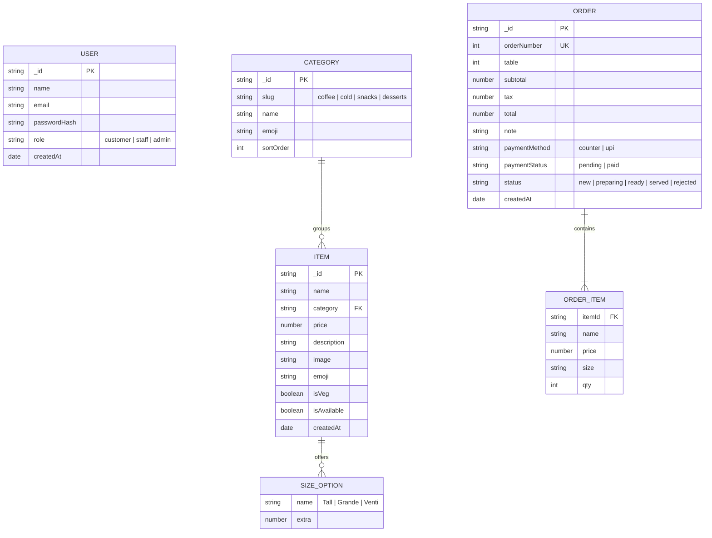
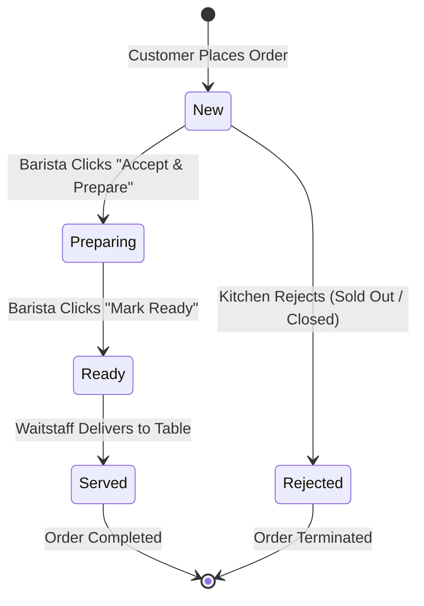

# ☕ Café Emerald — Production MERN Table Ordering & Kitchen Live KDS

> **A high-speed, contactless QR table-ordering platform and real-time Kitchen Display System (KDS)** built with React 18 (Vite), Tailwind CSS, Framer Motion, Node.js, Express, MongoDB/Mongoose, and Socket.io.

---

## 📑 Table of Contents
- [1. Overview & Key Capabilities](#1-overview--key-capabilities)
- [2. System Architecture](#2-system-architecture)
- [3. End-to-End User Flow](#3-end-to-end-user-flow)
- [4. Real-Time WebSocket Event Flow](#4-real-time-websocket-event-flow)
- [5. Database Schema & Data Models](#5-database-schema--data-models)
- [6. Order Lifecycle State Machine](#6-order-lifecycle-state-machine)
- [7. Design System & UI Specification](#7-design-system--ui-specification)
- [8. Project Directory Structure](#8-project-directory-structure)
- [9. REST API Reference](#9-rest-api-reference)
- [10. Quick Start & Local Setup](#10-quick-start--local-setup)
- [11. Docker & Production Deployment](#11-docker--production-deployment)
- [12. Self-Review & Troubleshooting](#12-self-review--troubleshooting)

---

## 1. Overview & Key Capabilities

Café Emerald transforms the dining experience into a frictionless, app-free digital ordering workflow:

1. **Contactless Customer QR Ordering (`/?table=X`)**:
   - Dynamic table number detection via QR parameter.
   - **Compact Full-Bleed Portrait Cards (~220px × 330px)** with studio food photography, 3-dot carousel indicators, coral-red prices (`#ff4757`), and inline quantity steppers.
   - **Zero-Blur Crystal Lighting**: Multi-stop dark vignette gradient without milky backdrop blur so the food stays 100% sharp and appetizing.
   - **Size Options Modal**: Dedicated cup selector (Tall, Grande, Venti) with custom prices.
   - **Live Slide-Over Cart**: Kitchen special notes, payment selector (UPI / Pay at Counter), and 5% tax breakdown.
   - **Live Order Tracker**: Real-time progress timeline (Received → Preparing → Ready → Served) powered by WebSockets.

2. **Kitchen KDS & Barista Live Board (`/admin`)**:
   - Real-time **Socket.io Kanban Dispatch Board** with columns for *New*, *In Kitchen (Preparing)*, and *Ready for Table*.
   - One-click status transitions that immediately sync with the customer's live tracker.
   - Resilient database adapter: connects seamlessly to **MongoDB** when available, and automatically provides a zero-config persistent JSON fallback store if local MongoDB is offline.

---

## 2. System Architecture

The following diagram illustrates the complete client-server-database topography and communication protocols:



---

## 3. End-to-End User Flow

The journey of a guest from table arrival to completed meal service:



---

## 4. Real-Time WebSocket Event Flow

How the customer's phone and the kitchen's Kanban board maintain real-time bi-directional synchronization without page refreshing:



---

## 5. Database Schema & Data Models

Entity relationships and fields across users, categories, menu items, and customer orders:



---

## 6. Order Lifecycle State Machine

Allowed state transitions for an order through the Kitchen Display System:



---

## 7. Design System & UI Specification

### 7.1 Palette & Tokens
* **Background Dark**: `#071a12` (Deep Forest Noir)
* **Surface Container**: `#0d281e` (Sleek Emerald Card Container)
* **Accent / Mint**: `#38d39f` (Focus indicators, active pills, step rings)
* **Alert / Price**: `#ff4757` (High-contrast prices, sold-out tags, favorite hearts)
* **Typography**: Google Font `Plus Jakarta Sans`, tight tracking (`-0.015em`)

### 7.2 The 220px × 330px Compact Card Architecture
The card dimensions and elements were engineered to match high-end mobile café standards:
* **Dimensions**: Width `210px–250px`, Aspect Ratio `1 / 1.44` (~`320px` height).
* **Desktop Grid**: Displays 3 to 4 cards per row instead of 2 massive billboard cards.
* **Mobile Grid**: Clean 2-column grid (`repeat(2, 1fr)`) to allow browsing without endless vertical scrolling.
* **Lighting Scrim**: Dark multi-stop gradient (`rgba(3, 14, 9, 0.98)` to `transparent`) at the bottom 25% only. **Zero backdrop blur**, keeping the food crisp and sharp.

---

## 8. Project Directory Structure

```text
cafe-app/
├── server/                      # Node.js + Express + Socket.io Server (MVC)
│   ├── config/
│   │   └── db.js                # Dual Mongo / Local JSON database connector
│   ├── controllers/
│   │   ├── authController.js    # Staff login & registration
│   │   ├── itemController.js    # Menu catalog CRUD & filters
│   │   └── orderController.js   # Order placement & status dispatcher
│   ├── middleware/
│   │   ├── auth.js              # JWT verification & RBAC guard
│   │   └── error.js             # Centralized JSON error handler
│   ├── models/
│   │   ├── User.js              # User model interface
│   │   ├── Category.js          # Menu category schema
│   │   ├── Item.js              # Menu dish item schema
│   │   ├── Order.js             # Table order schema
│   │   └── storeAdapter.js      # Zero-config resilient JSON data engine
│   ├── routes/
│   │   ├── authRoutes.js        # /api/auth endpoints
│   │   ├── itemRoutes.js        # /api/items endpoints
│   │   └── orderRoutes.js       # /api/orders endpoints
│   ├── utils/
│   │   └── generateToken.js     # JWT generation utility
│   ├── scripts/
│   │   └── seed.js              # Database seed script
│   ├── data/
│   │   └── store.json           # Active persistent data store
│   ├── .env.example
│   ├── Dockerfile
│   ├── package.json
│   └── server.js                # Main server entry point
├── client/                      # React 18 (Vite) + Tailwind CSS + Framer Motion
│   ├── src/
│   │   ├── api/
│   │   │   └── client.js        # Axios instance with JWT interceptor
│   │   ├── components/
│   │   │   ├── DishCard.jsx     # Compact ~220px × 330px full-bleed card
│   │   │   ├── DetailModal.jsx  # Cup size selection modal (Tall/Grande/Venti)
│   │   │   ├── CartDrawer.jsx   # Slide-over cart & payment drawer
│   │   │   └── LiveTracker.jsx  # Real-time WebSocket step tracker
│   │   ├── context/
│   │   │   ├── CartContext.jsx  # Cart state & tax calculation
│   │   │   └── SocketContext.jsx# Live Socket.io connection lifecycle
│   │   ├── pages/
│   │   │   ├── MenuPage.jsx     # Customer responsive menu view
│   │   │   └── AdminDashboardPage.jsx # Kitchen KDS Kanban board
│   │   ├── App.jsx              # Routing & context tree
│   │   ├── main.jsx             # React DOM mount point
│   │   └── index.css            # Tailwind directives & custom scrollbars
│   ├── dist/                    # Compiled production assets
│   ├── index.html
│   ├── tailwind.config.js
│   ├── vite.config.js
│   ├── Dockerfile
│   └── package.json
├── docker-compose.yml           # Unified Docker container configuration
└── README.md                    # Master documentation
```

---

## 9. REST API Reference

### 9.1 Menu & Catalog Endpoints

#### `GET /api/items`
Returns all menu items matching query filters.
* **Query Parameters**:
  - `category` (string, optional): Filter by category slug (e.g. `coffee`, `cold`, `snacks`, `desserts`).
  - `search` (string, optional): Search term matching name or description.
  - `vegOnly` (boolean, optional): Set `true` to return vegetarian items only.
* **Response (200 OK)**:
```json
{
  "success": true,
  "count": 6,
  "categories": [
    { "slug": "coffee", "name": "Coffee", "emoji": "☕" }
  ],
  "data": [
    {
      "_id": "item_capp_2",
      "name": "Cappuccino",
      "category": "coffee",
      "price": 180,
      "description": "Velvety micro-foam espresso crafted with artisanal dark roast beans.",
      "image": "https://images.unsplash.com/photo-1534778101976-62847782c213?w=800",
      "isVeg": true,
      "isAvailable": true,
      "sizes": [
        { "name": "Tall", "extra": 0 },
        { "name": "Grande", "extra": 30 },
        { "name": "Venti", "extra": 60 }
      ]
    }
  ]
}
```

---

### 9.2 Order Placement & Tracking

#### `POST /api/orders`
Places a new order for a table and broadcasts it immediately to the Kitchen KDS.
* **Request Payload**:
```json
{
  "table": 5,
  "items": [
    { "itemId": "item_cake_1", "name": "Strawberry Chocolate Cake", "price": 260, "size": "1 Slice", "qty": 1 },
    { "itemId": "item_capp_2", "name": "Cappuccino", "price": 180, "size": "Grande", "qty": 2 }
  ],
  "note": "Extra hot please",
  "paymentMethod": "upi"
}
```
* **Response (201 Created)**:
```json
{
  "success": true,
  "data": {
    "_id": "ord_1794658064276",
    "orderNumber": 1044,
    "table": 5,
    "subtotal": 620,
    "tax": 31,
    "total": 651,
    "status": "new",
    "createdAt": "2026-11-15T12:00:00.000Z"
  }
}
```

#### `PATCH /api/orders/:id/status`
Updates order status and triggers real-time customer tracker push notification.
* **Headers**: `Authorization: Bearer <TOKEN>`
* **Request Body**: `{ "status": "preparing" | "ready" | "served" | "rejected" }`

---

## 10. Quick Start & Local Setup

### Prerequisites
- Node.js `v18+` or `v20+`
- npm `v9+` or `v10+`

### Step 1: Install & Launch Server
The Express server automatically hosts both the REST API and the compiled React SPA:
```bash
cd server
npm install
node server.js
```

The application is now live at:
- **Customer Table Menu**: [http://localhost:5000/?table=1](http://localhost:5000/?table=1)
- **Kitchen KDS Live Board**: [http://localhost:5000/admin](http://localhost:5000/admin)

### Step 2 (Optional): Launch Vite Dev Server for Frontend Work
If you want to modify React components with Hot Module Replacement (HMR):
```bash
cd client
npm install
npm run dev
```
Opens on **[http://localhost:5173/?table=1](http://localhost:5173/?table=1)** and automatically proxies `/api` calls to port 5000.

---

## 11. Docker & Production Deployment

### 11.1 Run with Docker Compose
To run the full stack containerized with a single command:
```bash
docker-compose up --build
```
This launches:
- `server`: Node.js Express & Socket.io container on port `5000`
- `client`: Nginx container serving optimized React static assets on port `5173`

---

## 12. Self-Review & Troubleshooting

| Observation | Root Cause | Solution |
| :--- | :--- | :--- |
| **Cards looking too large on PC** | Grid was set to `minmax(280px, 1fr)`, expanding cards to 450px wide. | Replaced with strict `minmax(210px, 250px)` and `aspect-ratio: 1 / 1.44` (~320px height) to show 3–4 cards per row. |
| **Milky horizontal fog line** | `backdrop-filter: blur(16px)` on overlay. | Removed blur entirely; replaced with clean multi-stop dark vignette gradient. |
| **Local MongoDB not installed** | Windows environment missing local `mongod` service. | Built automatic fallback adapter (`server/models/storeAdapter.js`) that persists to JSON without crashing. |
| **Stale browser CSS on refresh** | Browser aggressive caching of `.css` files. | Configured `server.js` with `'Cache-Control': 'no-cache'` and Vite hash bundling. |
