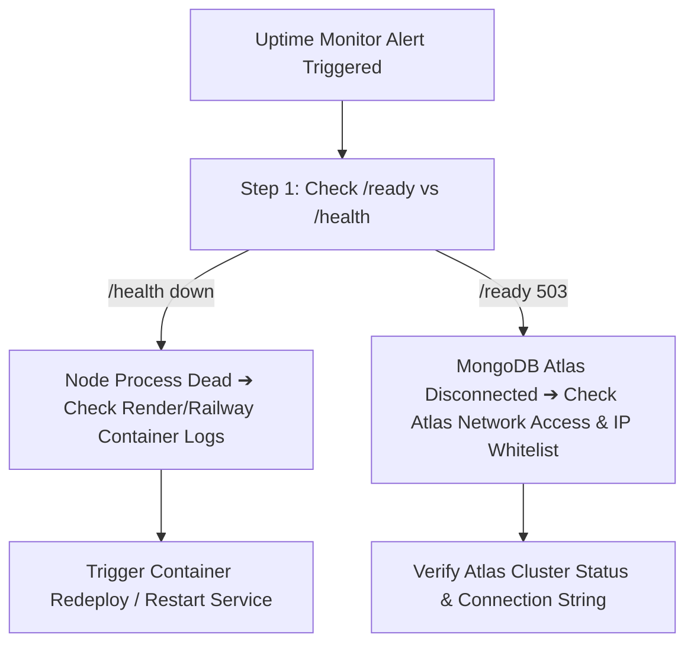

# ⏱️ Café Emerald — Production Uptime Monitoring Runbook

This guide details the setup and operational configuration for continuous uptime monitoring, synthetic health checks, and alerting for the Café Emerald production platform.

---

## 🎯 Target Service Level Agreement (SLA)

| Metric | Target | Alert Threshold | Escalation Window |
| :--- | :--- | :--- | :--- |
| **API Availability** | **99.9% Uptime** (< 43.8 mins downtime/month) | 2 consecutive failed health checks | Immediate (< 3 minutes) |
| **P95 Latency** | **< 350ms** | Response time > 1500ms for 3 mins | Warning (< 15 minutes) |
| **Database Readiness** | **100% Connectivity** | `/ready` returns 503 | Immediate (< 1 minute) |

---

## 🩺 Monitoring Endpoints & Probes

Café Emerald exposes two dedicated, unauthenticated, lightweight monitoring probes:

### 1. Liveness Probe (`GET /health`)
- **URL:** `https://api.yourcafe.com/health` (or `https://your-service.onrender.com/health`)
- **Purpose:** Verifies that the Node.js process and HTTP server are responsive.
- **Polling Interval:** **Every 30 seconds**
- **Success Criteria:** HTTP `200 OK`
- **Expected Payload:**
  ```json
  {
    "status": "healthy",
    "env": "production",
    "timestamp": "2026-11-16T00:45:00.000Z"
  }
  ```

### 2. Readiness Probe (`GET /ready`)
- **URL:** `https://api.yourcafe.com/ready`
- **Purpose:** Asserts that the backend is actively connected to MongoDB and Redis before routing customer traffic.
- **Polling Interval:** **Every 60 seconds**
- **Success Criteria:** HTTP `200 OK`
- **Failure Condition:** HTTP `503 Service Unavailable` if MongoDB is unreachable.
- **Expected Payload:**
  ```json
  {
    "status": "ready",
    "database": "connected",
    "uptime": 86400,
    "timestamp": "2026-11-16T00:45:00.000Z"
  }
  ```

---

## 🛠️ Step-by-Step Setup Guide

### Option A: Better Uptime / Better Stack (Recommended)
1. Sign in to [Better Stack](https://betterstack.com/).
2. Navigate to **Monitors** ➔ **Create Monitor**.
3. Configure **Monitor 1 (Liveness)**:
   - **Type:** HTTP
   - **URL:** `https://<YOUR_BACKEND_URL>/health`
   - **Check Frequency:** 30 seconds
   - **HTTP Method:** GET
   - **Expected Status:** `200`
4. Configure **Monitor 2 (Readiness & DB)**:
   - **URL:** `https://<YOUR_BACKEND_URL>/ready`
   - **Check Frequency:** 1 minute
   - **Response Content Matching:** Must contain `"database":"connected"`
5. Connect Alert Channels:
   - Add café manager WhatsApp/SMS, kitchen Telegram group, or team Slack channel (`#alerts-prod`).

### Option B: UptimeRobot (Free Alternative)
1. Sign in to [UptimeRobot](https://uptimerobot.com/).
2. Add New Monitor:
   - **Monitor Type:** HTTP(s)
   - **Friendly Name:** `Cafe Emerald - API Health`
   - **URL:** `https://<YOUR_BACKEND_URL>/health`
   - **Monitoring Interval:** 1 minute
3. Add Second Monitor:
   - **Friendly Name:** `Cafe Emerald - DB Readiness`
   - **URL:** `https://<YOUR_BACKEND_URL>/ready`
   - **Keyword Monitoring:** Alert if `"database":"connected"` is NOT found.

---

## 🚨 Incident Triage & Recovery Runbook

When an uptime check alerts as **DOWN**:



1. **Check Process vs DB:**
   - Run `curl -i https://<YOUR_BACKEND_URL>/ready`
   - If `/health` is up but `/ready` is 503, the problem is MongoDB Atlas or IP access list.
2. **Inspect Sentry Dashboard:**
   - Check [Sentry Issues Dashboard](https://sentry.io/) for recent unhandled exceptions or crash reports.
3. **Emergency Staff Communication:**
   - If the outage exceeds 2 minutes, instruct kitchen staff to refer to the [Pilot Kit Staff Guide](PILOT_KIT.md) for offline counter ordering.
